# ha-waste-card

[](https://www.home-assistant.io/integrations/marketplace/)
[](https://github.com/juju35/ha-waste-card/actions/workflows/hacs.yml)
[](https://github.com/juju35/ha-waste-card/actions/workflows/validate.yml)
[](https://github.com/juju35/ha-waste-card/actions/workflows/lint.yml)
[](https://github.com/juju35/ha-waste-card/releases/latest)
[](https://github.com/juju35/ha-waste-card/blob/main/LICENSE)
[](https://buymeacoffee.com/julienstep9)

Lovelace cards for Home Assistant showing your **waste collections**: the next collection of every bin (household waste, recycling, paper, glass, organic, garden, bulky waste…) with a countdown — *today*, *tomorrow*, *in 5 days* —, the bins to **put out tonight** highlighted, and the list of the next collection days.

The cards read the sensors of [Waste Collection Schedule](https://github.com/mampfes/hacs_waste_collection_schedule), the events of any **calendar** entity and any **sensor whose state is a date**. Each collection type is recognized in many languages (`Restmüll`, `Ordures ménagères`, `Gelber Sack`, `GFT`…) and gets the color and the icon of its waste category; both can be changed per type.

[](https://my.home-assistant.io/redirect/marketplace_repository/?owner=juju35&repository=ha-waste-card&category=plugin)

| Waste Card | Waste Mini Card |
|---|---|
| 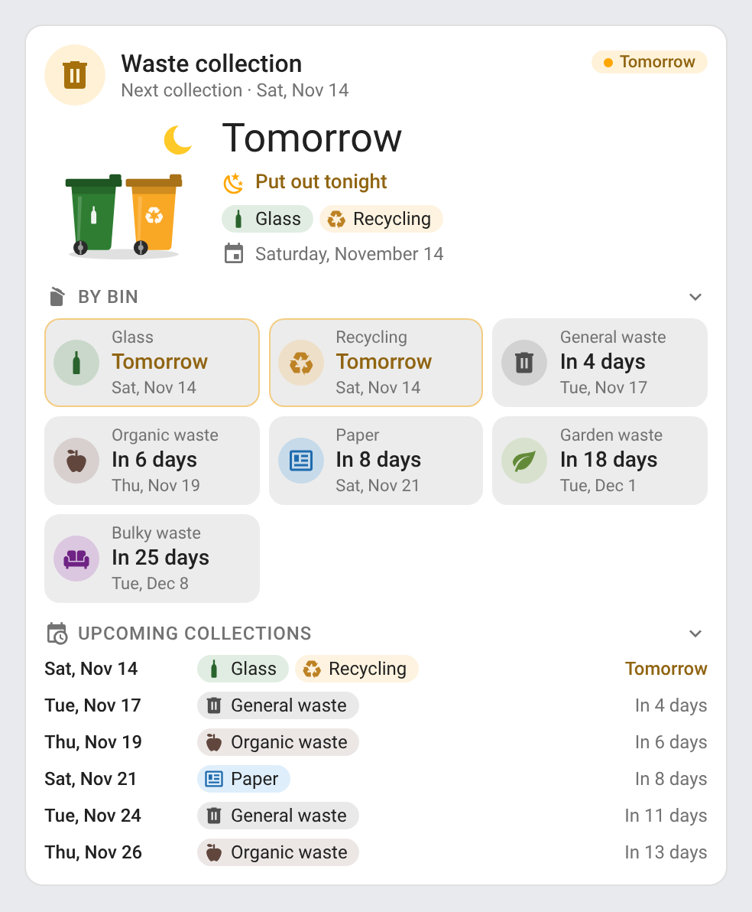 | 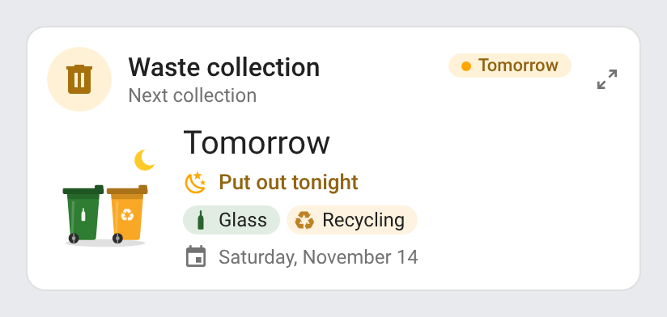 |

## Features

- Two cards: a full **Waste Card** (`custom:waste-card`) and a compact **Waste Mini Card** (`custom:waste-mini-card`, next collection only)
- Drawn wheelie bins of the next collection, in the color of their type with its icon on the front, **animated** by what is due: rolled to the kerb under the moon the evening before, lids lifting with pulsing rings on collection day (see [Animations](#animations))
- Countdown worded in your language (*Today*, *Tomorrow*, *In 3 days*, *Übermorgen*…), and the date of the collection
- **Put out tonight**: the day before a collection the card highlights the bins to take out, from the hour you choose (`tonight_from`); **Collection today** on the day itself
- Next collection **per bin type**: one tile per type with its countdown and date, the ones due today or tomorrow outlined
- **Upcoming collections**: the next collection days with their bins
- Header icon and status chip colored by the next collection: blue today, orange tomorrow, green later
- Several sources in one card (a Waste Collection Schedule sensor, a calendar, a date sensor…): the same collection given by two of them is shown once
- Waste categories recognized in many languages: household waste, recycling / packaging, paper, glass, organic, garden waste, bulky waste, hazardous waste, textiles, electronics; names as given by the source, or the translated category (`type_names: category`)
- Own name, color and icon per type (`types`), or per entity
- Collapsible sections, folded back by a click anywhere else on the page
- Detail button on the mini card (top right): it switches the mini card to the full card's content and back; a click anywhere outside the card brings the compact view back
- Click a collection to open the Home Assistant more-info of its entity
- Visual editor in the dashboard UI for both cards (no YAML needed), every option also in YAML
- Light and dark mode, English, French, German, Spanish, Serbian (Cyrillic and Latin), Italian, Dutch, European Portuguese, Polish, Romanian, Danish, Swedish, Bulgarian, Russian, Ukrainian, Hungarian, Slovak, Czech, Slovenian, Latvian and Greek
- Single file, no external dependency; each language other than English is a small file loaded only when needed

## Supported integrations

| Source | Entities | What the cards read |
|---|---|---|
| [Waste Collection Schedule](https://github.com/mampfes/hacs_waste_collection_schedule) (custom) | `sensor` and `calendar` entities of the integration — found automatically when `entities` is not set | Sensors: every `details_format` — `upcoming` (one attribute per date), `appointment_types` (one attribute per type), `generic` (`upcoming` list) — and, with `hidden`, the state (`Paper, Glass in 2 days`, or your `value_template` with `add_days_to`). Calendars: their events |
| Any calendar integration — [Local Calendar](https://www.home-assistant.io/integrations/local_calendar/), [Google Calendar](https://www.home-assistant.io/integrations/google/), [CalDAV](https://www.home-assistant.io/integrations/caldav/), [Remote Calendar](https://www.home-assistant.io/integrations/remote_calendar/) (an ICS feed of your municipality)… | `calendar` entities | The events of the next `days` (60 by default), through the calendar REST API or, when it is not available, the `calendar.get_events` action; the summary is the collection type (`Paper, Glass` gives two collections; the calendars of Waste Collection Schedule hold one type per event and are not split) |
| Any sensor whose state is a date — a [template sensor](https://www.home-assistant.io/integrations/template/), another waste integration… | `sensor` entities | A date (`2026-11-14`, `14.11.2026`), a timestamp (`device_class: timestamp`), or a number of days (unit `d` / `days`, or a `daysTo` attribute). The collection type is the entity's name, or the `name` / `type` set on the entity |

## Prerequisites

Home Assistant 2024.8 or later, with at least one of the [supported sources](#supported-integrations).

## Installation

### Via the Marketplace (recommended)

Click the button below to add the repository directly:

[](https://my.home-assistant.io/redirect/marketplace_repository/?owner=juju35&repository=ha-waste-card&category=plugin)

Then click **Install**, and reload your browser when the Marketplace asks you to.

Or manually:

1. Open **Settings → Marketplace → Add from link** (top right; this needs a GitHub account connected)
2. Add `https://github.com/juju35/ha-waste-card` — Type: **Dashboard**
3. Open **Waste Card** and click **Install**
4. Clear your browser cache and refresh

The Marketplace adds the resource `/local/community/ha-waste-card/waste-card.js`.

### Manual

1. Download `waste-card.js` and the `waste-card.i18n.*.js` translation files from the [latest release](https://github.com/juju35/ha-waste-card/releases/latest)
2. Copy them all to `/config/www/` (without the translation files, the cards show in English)
3. Go to **Settings → Dashboards → ⋮ → Resources** → Add resource:
   - URL: `/local/waste-card.js`
   - Type: **JavaScript Module**
4. Clear your browser cache and refresh

## Configuration

### Card types

| Card | Type |
|---|---|
| Waste Card | `custom:waste-card` |
| Waste Mini Card | `custom:waste-mini-card` |

### Visual editor

Edit a dashboard, click **Add card** and search for **Waste Card** or **Waste Mini Card**. The sensors and calendars of Waste Collection Schedule are preselected; pick other entities in the list, set an optional title, the hour of the evening highlight, the sections and the language. The preview updates live, and options left at their default are kept out of the generated YAML. Per-type names, colors and icons (`types`) and per-entity settings are set in YAML; the editor keeps them.

### Minimal

With Waste Collection Schedule, nothing to set: its sensors and calendars are found on their own.

```yaml
type: custom:waste-card
```

```yaml
type: custom:waste-mini-card
entities:
  - sensor.waste_collection
```

### Full options

```yaml
type: custom:waste-card
title: Bins
entities:
  - sensor.waste_collection          # Waste Collection Schedule
  - calendar.municipal_collections   # any calendar
  - entity: sensor.bulky_waste_date  # a date sensor, with its own settings
    name: Bulky waste
    type: bulky
type_names: source
types:
  - match: Recycling                 # text contained in the collection type (case and accents ignored)
    name: Yellow bin
    color: "#fdd835"
  - match: /organic|garden/          # or a regular expression
    name: Brown bin
    color: "#8d6e63"
    icon: mdi:leaf
  - match: Glass
    category: glass
    icon: mdi:bottle-wine
tonight_from: 16
show_title: true
show_subtitle: true
show_bins: true
show_upcoming: true
max_items: 6
days: 60
collapsed:
  - upcoming
language: en
```

```yaml
type: custom:waste-mini-card
entities:
  - sensor.waste_collection
title: Bins
tonight_from: 16
zoom: true
language: en
```

### Options reference

| Option | Card | Default | Description |
|---|---|---|---|
| `entities` | both | Waste Collection Schedule entities | Sources of the collections: entity ids, or objects with `entity` and optional `name` (collection type of a date sensor or of every event of a calendar), `type` (waste category, see below), `icon` and `color` |
| `title` | both | *Waste collection* (translated) | Card title |
| `show_title` | both | `true` | Show the title in the header (e.g. `false` under a section heading of your own) |
| `show_subtitle` | both | `true` | Show the subtitle (next collection day) under the title |
| `tonight_from` | both | `0` | Hour (0–23) from which a collection due tomorrow is highlighted as **Put out tonight**; `0`: the whole day before |
| `type_names` | both | `source` | Name of each collection type: `source` (as the source gives it, e.g. `Restmüll`) or `category` (the translated waste category, e.g. *Household waste*) |
| `types` | both | — | Settings per collection type, as a list: `match` (text contained in the type, or `/regex/`; defaults to `name`), `name`, `category`, `icon` (`mdi:…`) and `color` (any CSS color). The first matching entry wins |
| `days` | both | `60` | Days of calendar events read ahead |
| `zoom` | mini | `true` | Detail button at the top right of the mini card: it shows the full card's content and switches back to the compact view; a click outside the card also brings the compact view back. `false` removes the button |
| `show_bins` | full | `true` | Next collection per bin type |
| `show_upcoming` | full | `true` | List of the next collection days |
| `max_items` | full | `6` | Collection days in the list |
| `collapsed` | full | `[]` | Sections folded by default, among `bins` and `upcoming`. Click a section title (or Tab to it and press Enter or Space) to fold or unfold it; a click anywhere else folds it back |
| `language` | both | Auto | Force language: `fr`, `en`, `de`, `es`, `sr`, `sr-Latn`, `it`, `nl`, `pt`, `pl`, `ro`, `da`, `sv`, `bg`, `ru`, `uk`, `hu`, `sk`, `cs`, `sl`, `lv` or `el` (auto-detects from HA settings) |

### Waste categories

The category of a collection type gives its default icon and color. It is recognized from the type's name in many languages, or set with `category` (in `types`) or `type` (on an entity):

| Category | Recognized from (examples) | Icon | Color |
|---|---|---|---|
| `garbage` | General waste, Household waste, Restmüll, Ordures ménagères, Restafval, Black bin | `mdi:trash-can` | `#616161` |
| `recycling` | Recycling, Packaging, Gelber Sack, Emballages, PMD | `mdi:recycle` | `#f9a825` |
| `paper` | Paper, Cardboard, Papier, Carta | `mdi:newspaper-variant-outline` | `#1e88e5` |
| `glass` | Glass, Verre, Altglas, Vidrio | `mdi:bottle-wine` | `#2e7d32` |
| `organic` | Organic, Food waste, Biomüll, Biodéchets, GFT | `mdi:food-apple` | `#795548` |
| `garden` | Garden waste, Green waste, Déchets verts, Grünschnitt, Christmas trees | `mdi:leaf` | `#7cb342` |
| `bulky` | Bulky waste, Encombrants, Sperrmüll, Grofvuil | `mdi:sofa` | `#8e24aa` |
| `hazardous` | Hazardous waste, Schadstoffe, Déchets dangereux | `mdi:biohazard` | `#e53935` |
| `textile` | Textiles, Clothes, Altkleider | `mdi:tshirt-crew` | `#ec407a` |
| `electronics` | Electronics, WEEE, Elektroschrott, DEEE | `mdi:television-classic` | `#00897b` |
| `other` | anything else | `mdi:trash-can-outline` | `#78909c` |

Bin colors differ from one town to another: set yours with `types`.

## Screenshots

Every capture is taken on a Friday at 18:30, with a Waste Collection Schedule sensor (`details_format: upcoming`) and a date sensor for the bulky waste: the recycling and the glass are collected the next morning.

| Light | Dark |
|---|---|
|  | 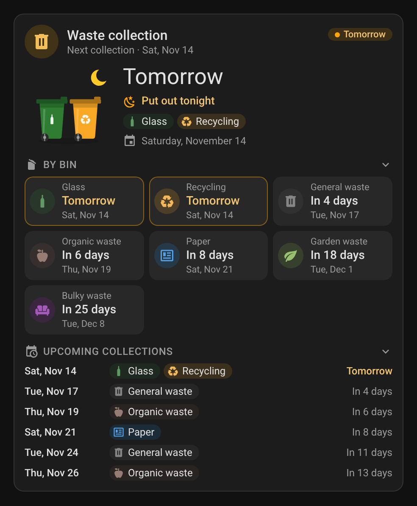 |
|  | 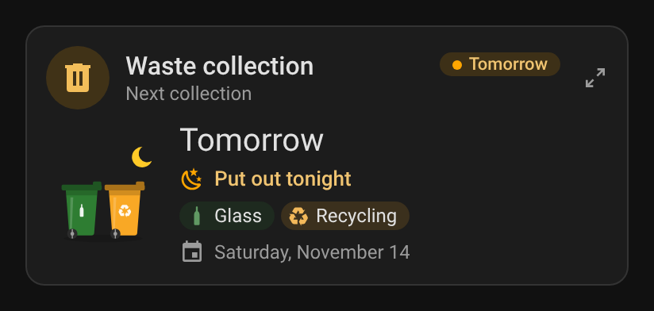 |

Mini card zoomed in with its detail button (top right, click it again or anywhere outside the card to go back):

| Light | Dark |
|---|---|
| 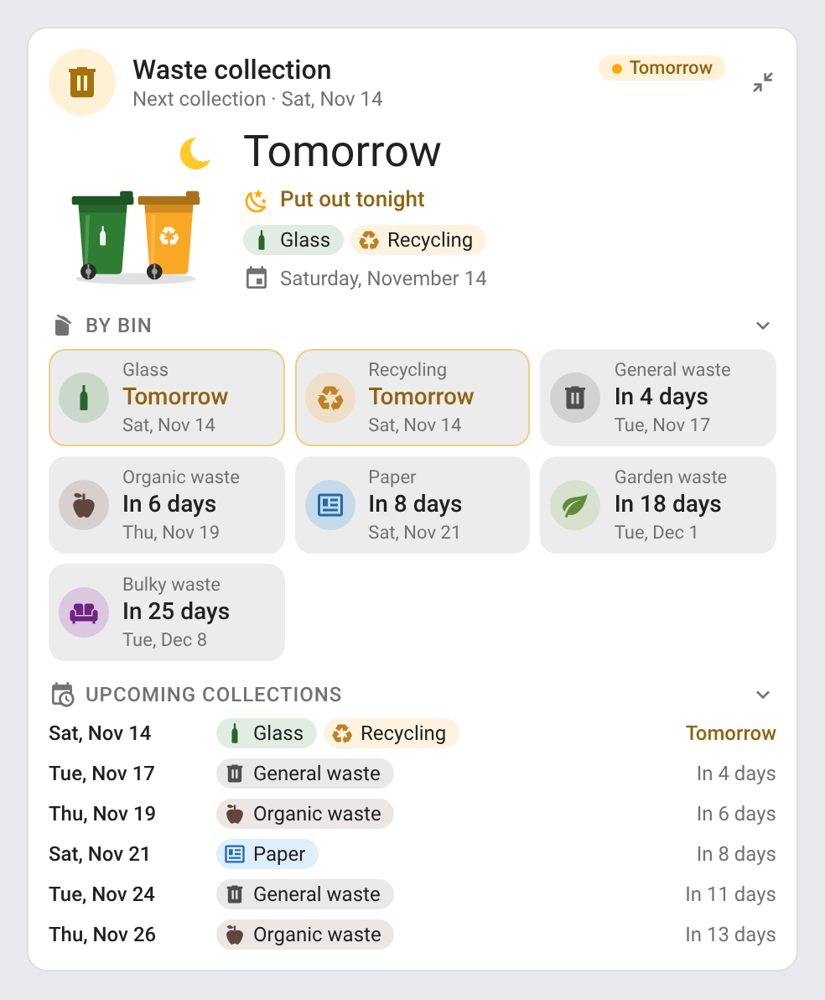 |  |

A calendar (the events of a Waste Collection Schedule calendar), with `type_names: category`: *Packaging* shows as *Recycling*, *Food waste* as *Organic waste*, *Christmas trees* as *Garden waste*:

| Light | Dark |
|---|---|
| 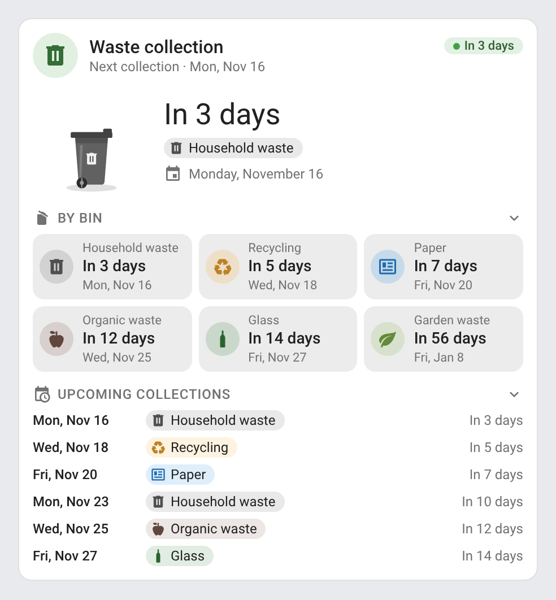 | 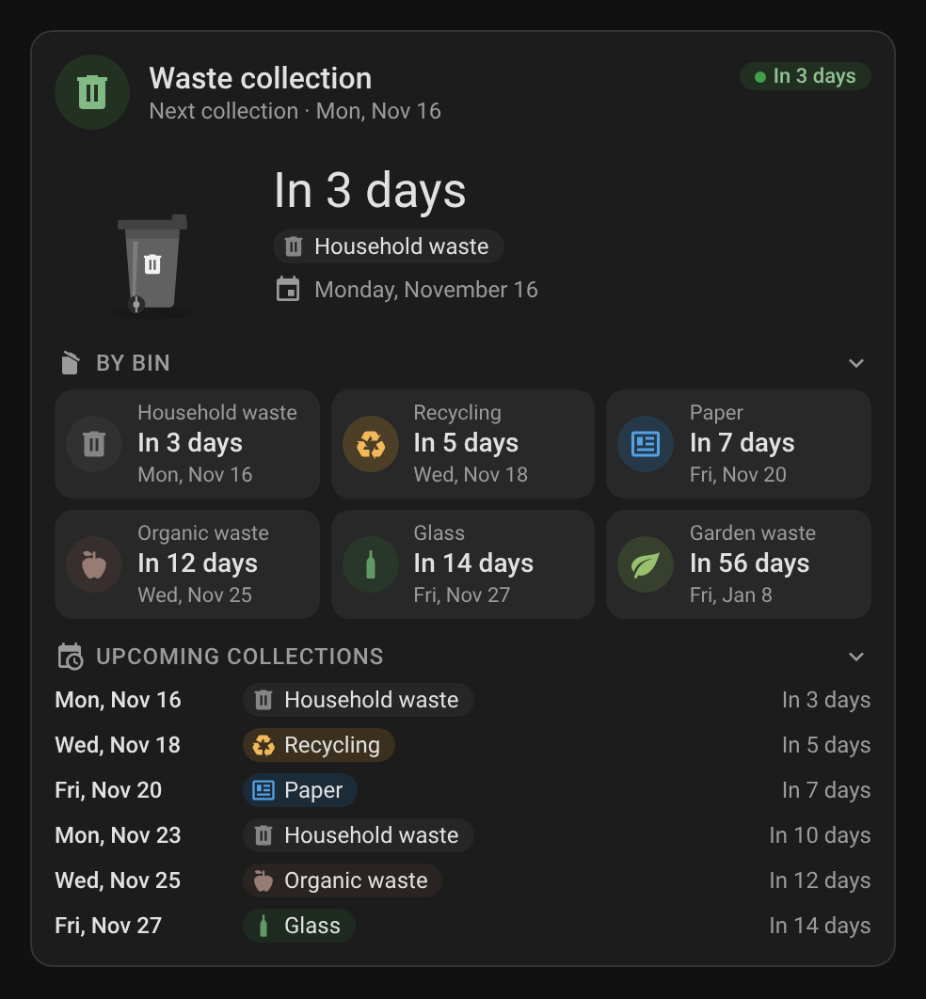 |

Own names, colors and icons per bin (`types`), the upcoming list folded (`collapsed: [upcoming]`, its chevron points right):

| Light | Dark |
|---|---|
| 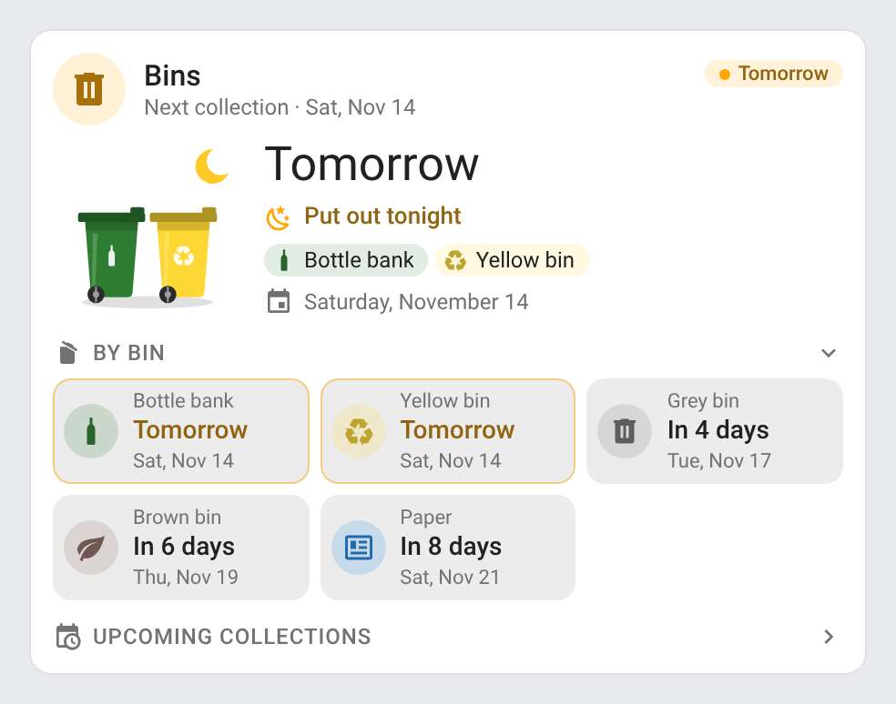 | 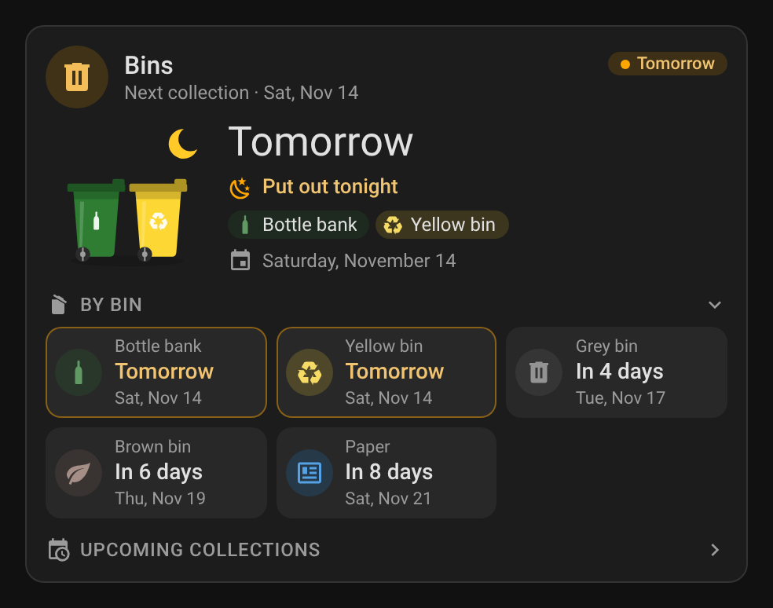 |

Narrow cards on a phone: the full card at 6 of 12 columns of a Sections view (238 px) — the tiles go two by two without their badge, the bins of each day under its date — and the mini card in a two-column grid (170 px):

| Light | Dark |
|---|---|
| 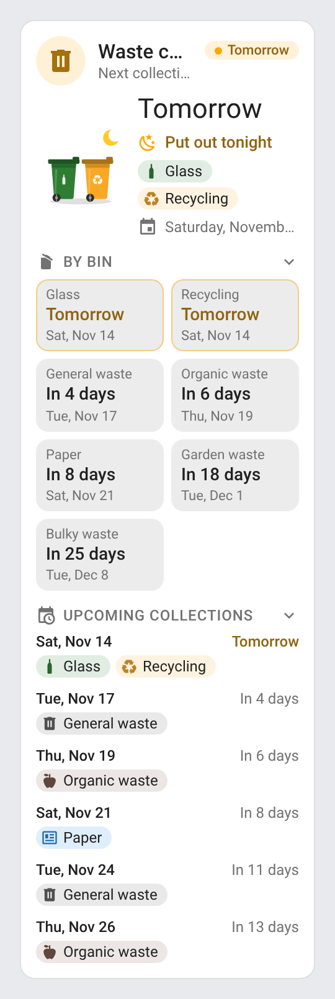 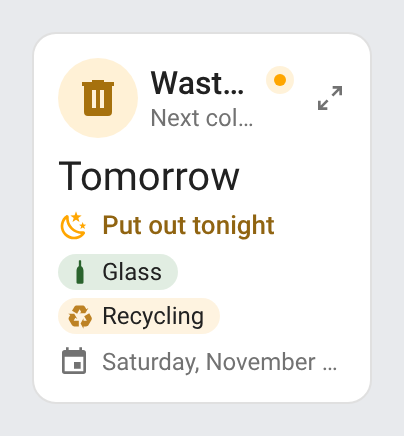 | 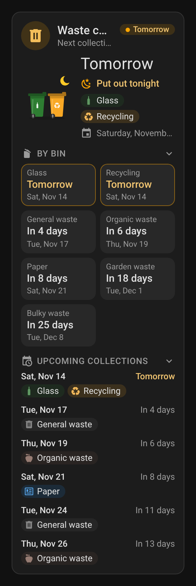 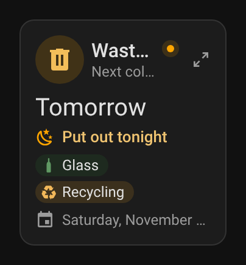 |

### Animations

The bins animate only when a collection is close, and stand still otherwise; every animation honours `prefers-reduced-motion`.

**Put out tonight** — the day before a collection (from `tonight_from`), the bins roll to the kerb, wheels turning, under the moon and twinkling stars:

| Light | Dark |
|---|---|
| 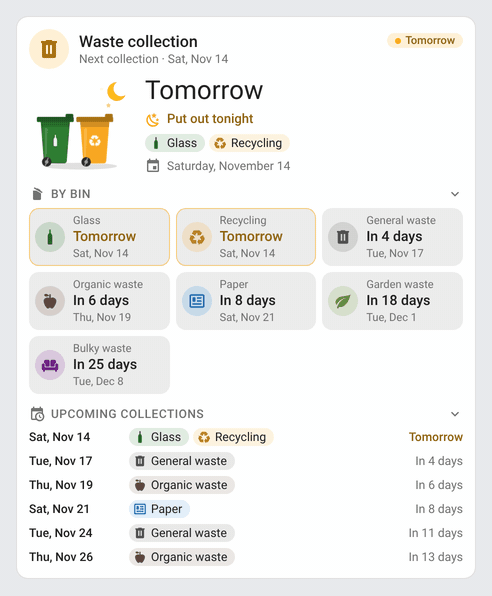 | 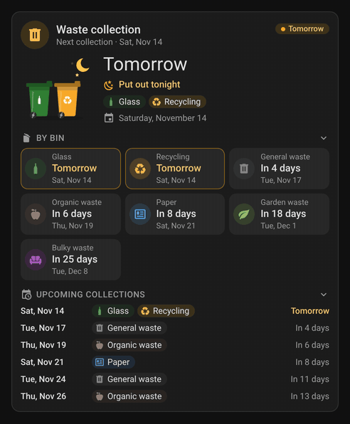 |

**Collection today** — on collection day, the lids lift one after the other as the bins are emptied, and blue rings pulse around them:

| Light | Dark |
|---|---|
| 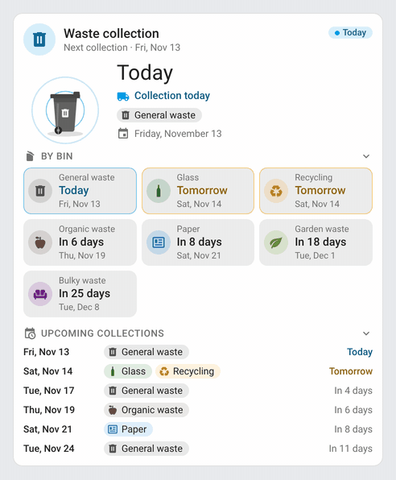 | 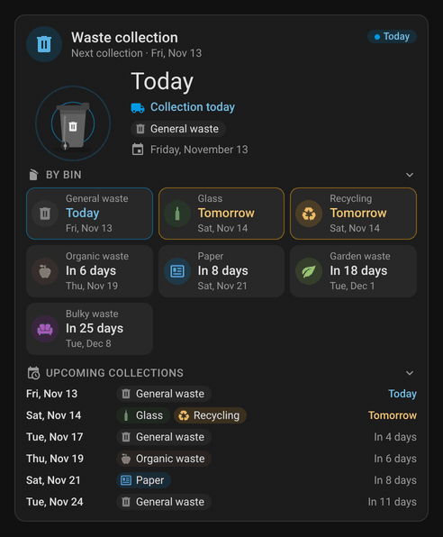 |

## How it works

Each entity gives a list of collections (a day and a type):

- **Waste Collection Schedule sensors**: the attributes, whatever the `details_format` — `upcoming` (`2026-11-14: Recycling, Glass`, split on the separator), `appointment_types` (`Recycling: 2026-11-14`) or `generic` (`upcoming: [{date, type}]`); with `hidden`, the state: the default `Recycling, Glass in 1 days`, or a `value_template` giving the types together with the `daysTo` attribute (`add_days_to: true`). Dates rendered by a `date_template` are read as `YYYY-MM-DD`, `DD.MM.YYYY` or `DD/MM/YYYY`.
- **Calendars**: the events of the next `days`, read once and again when the calendar's state changes (its next event moved) or after an hour; until they arrive, the calendar's own next event.
- **Date sensors**: the state as a date, a timestamp (converted to your local day) or a number of days, counted from the day the state was written.

Days follow the time zone of your Home Assistant profile (your browser's, or the server's when the profile says so). Collections before today are left out; the same type on the same day from two entities is shown once. The countdown and the evening highlight follow the clock (checked every minute), so the card turns from *Tomorrow* to *Today* at midnight on its own.

The countdown and dates are formatted by the browser's `Intl` in the card's language, so plurals and words like *the day after tomorrow* are right in every language.

## License

[MIT](LICENSE)
